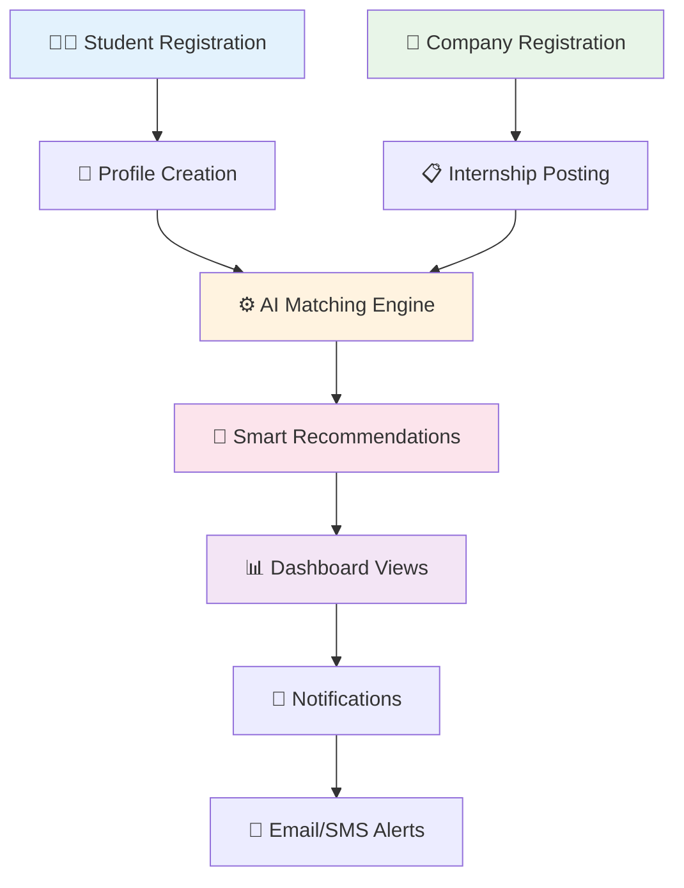

# 🎓 InternGenius - National Internship Portal

[](https://github.com/vishakha1221/InternGenius)
[](https://github.com/vishakha1221/InternGenius)
[](https://python.org)
[](https://flask.palletsprojects.com)
[](https://mongodb.com)
[](LICENSE)

> **🚀 An AI-powered platform that intelligently matches students with internship opportunities based on their skills, interests, and profiles - ensuring equal access for all students regardless of background or digital literacy.**

---

## 📋 Table of Contents

- [🎯 Problem Statement & Solution](#-problem-statement--solution)
- [⚡ Quick Start](#-quick-start)
- [🏗️ Architecture Overview](#️-architecture-overview)
- [💻 Installation & Setup](#-installation--setup)
- [📁 Project Structure](#-project-structure)
- [🎭 User Roles & Features](#-user-roles--features)
- [🔐 Security & Best Practices](#-security--best-practices)
- [🧪 Testing](#-testing)
- [🚀 Deployment](#-deployment)
- [🛠️ Technology Stack](#️-technology-stack)
- [📖 API Documentation](#-api-documentation)
- [🤝 Contributing](#-contributing)
- [📞 Support](#-support)

---

## 🎯 Problem Statement & Solution

### 🚩 The Problem (PS 25033)
The PM Internship Scheme faces challenges in matching thousands of students with appropriate internships:
- **Skill Mismatch**: Students struggle to identify relevant opportunities
- **Digital Divide**: First-generation learners lack digital exposure
- **Inefficient Filtering**: Manual searching leads to misaligned applications
- **Accessibility Barriers**: Complex interfaces exclude many students

### 💡 Our Solution
InternGenius provides an intelligent, inclusive platform that:
- ✅ **AI-Powered Matching**: Smart recommendations based on profiles
- ✅ **Simplified Interface**: Accessible design for all skill levels
- ✅ **Multi-Modal Support**: Works in online/offline modes
- ✅ **Comprehensive Tracking**: End-to-end application management
- ✅ **Government Standards**: Secure, scalable, and compliant

---

## ⚡ Quick Start

### 🚀 One-Click Setup (Recommended)

```bash
# Clone and enter directory
git clone https://github.com/vishakha1221/InternGenius.git
cd InternGenius

# Auto setup (handles everything)
python setup.py

# OR Manual setup:
python -m venv venv
venv\Scripts\activate  # Windows
# source venv/bin/activate  # Linux/Mac
pip install -r requirements.txt

# Test MongoDB connection (optional)
python test_mongodb.py

# Run the application
python app.py

# 🎉 Open browser: http://127.0.0.1:5000
```

### 🎮 Demo Mode
The application runs in **demo mode** when MongoDB is not available:
- ✅ All features fully functional using session storage
- ✅ Perfect for development and testing
- ✅ No database setup required initially
- ✅ Easy transition to production database later

### 🗂️ Test Accounts
```
👨‍🎓 Student Login: any-email@example.com / demo123
🏢 Company Login: company@example.com / demo123  
👩‍💼 Admin Login: admin@example.com / demo123
```

---

## 🏗️ Architecture Overview

### 🔄 System Flow



### 🧠 Core Components

| Component | Description | Technology |
|-----------|-------------|------------|
| **🔐 Authentication** | Secure user management with role-based access | Flask-Login, bcrypt |
| **📊 Profile Engine** | Comprehensive student/company profiles | MongoDB, WTForms |
| **🤖 AI Matcher** | Intelligent internship recommendations | Scikit-learn, ML algorithms |
| **📱 Dashboard System** | Role-specific interfaces (Student/Company/Admin) | Flask, Jinja2, Bootstrap |
| **🔔 Notification Hub** | Multi-channel alerts and updates | Email, SMS integration ready |
| **📈 Analytics** | Real-time insights and performance metrics | MongoDB aggregation |

---

## 💻 Installation & Setup

### 📋 Prerequisites
- **Python 3.8+** ([Download](https://python.org/downloads))
- **Git** ([Download](https://git-scm.com/downloads))
- **MongoDB** (Local or Atlas account - Optional for demo mode)

### 🔧 Detailed Setup

#### 1️⃣ Clone Repository
```bash
git clone https://github.com/vishakha1221/InternGenius.git
cd InternGenius
```

#### 2️⃣ Create Virtual Environment
```bash
# Create environment
python -m venv venv

# Activate environment
# Windows (PowerShell)
venv\Scripts\Activate.ps1
# Windows (Command Prompt)  
venv\Scripts\activate.bat
# Linux/Mac
source venv/bin/activate
```

#### 3️⃣ Install Dependencies
```bash
pip install -r requirements.txt
```

#### 4️⃣ Environment Configuration
```bash
# Create environment file (optional)
copy .env.example .env  # Windows
cp .env.example .env    # Linux/Mac

# Edit .env file with your settings:
# SECRET_KEY=your-secret-key-here
# MONGO_URI=your-mongodb-connection-string
# FLASK_ENV=development
```

#### 5️⃣ Database Setup (Optional)

**Option A: MongoDB Atlas (Cloud) - Recommended**
```bash
# The app is pre-configured for MongoDB Atlas
# Just update your password in .env file:
MONGO_URI=mongodb+srv://<username>:<password>@<cluster-host>/<database>?retryWrites=true&w=majority

# Test connection
python test_mongodb.py
```

**Option B: Local MongoDB**
1. Install [MongoDB Community](https://www.mongodb.com/try/download/community)
2. Start MongoDB service
3. Update .env: `MONGO_URI=mongodb://localhost:27017/interngenius`

**Option C: Demo Mode (No Setup Required)**
- Skip database setup entirely
- Application automatically runs with session storage
- All features work perfectly for development and testing

#### 6️⃣ Run Application
```bash
# Method 1: Direct run (Recommended)
python app.py

# Method 2: Flask CLI
flask run

# Method 3: Using Gunicorn (Production)
gunicorn -w 4 -b 0.0.0.0:5000 app:app
```

#### 7️⃣ Access Application
- **Homepage**: http://127.0.0.1:5000
- **Admin Panel**: http://127.0.0.1:5000/admin/dashboard
- **API Health**: http://127.0.0.1:5000/health

---

## 📁 Project Structure

```
InternGenius/
│
├── 🔧 Configuration Files
│   ├── app.py                 # Main Flask application
│   ├── config.py              # Environment configurations  
│   ├── requirements.txt       # Python dependencies
│   ├── Procfile              # Heroku deployment config
│   └── .env.example          # Environment template
│
├── 📊 Data Models
│   └── models/
│       ├── user_model.py     # User authentication model
│       ├── student_profile.py # Student data schema
│       ├── company_profile.py # Company data schema
│       ├── internship.py     # Internship listings model
│       └── application.py    # Application tracking model
│
├── 🌐 Web Interface
│   ├── templates/
│   │   ├── base.html         # Base template layout
│   │   ├── index.html        # Homepage
│   │   ├── auth/             # Login/Signup pages
│   │   │   ├── login.html
│   │   │   ├── signup.html
│   │   │   └── forgot_password.html
│   │   ├── dashboards/       # Role-specific dashboards
│   │   │   ├── student_dashboard.html
│   │   │   ├── company_dashboard.html
│   │   │   └── admin_dashboard.html
│   │   ├── registration/     # Registration forms
│   │   └── errors/           # Error pages (404, 500)
│   │
│   └── static/
│       ├── css/
│       │   ├── style.css     # Main stylesheet
│       │   ├── govt-styles.css # Government theme
│       │   └── profile-styles.css # Profile forms
│       ├── js/
│       │   ├── main.js       # Core JavaScript
│       │   └── accessibility.js # Accessibility features
│       ├── images/           # Logos and icons
│       └── uploads/          # User uploaded files
│           ├── resumes/
│           └── photos/
│
├── 📝 Forms & Validation  
│   └── forms/
│       ├── auth_forms.py     # Authentication forms
│       ├── profile_forms.py  # Profile completion forms
│       └── admin_forms.py    # Admin management forms
│
├── 🤖 AI/ML Module (Future)
│   └── ml_module/
│       ├── recommendation_engine.py
│       ├── skill_assessment.py
│       └── analytics.py
│
├── 🧪 Testing
│   ├── test_main.py          # Core functionality tests
│   ├── test_auth.py          # Authentication tests
│   ├── test_student.py       # Student features tests
│   └── run_tests.py          # Test runner
│
├── 📚 Documentation
│   ├── docs/
│   │   ├── api-documentation.md
│   │   └── project-structure.md
│   ├── database/
│   │   └── schema.md
│   └── demo/
│       └── README.md         # Demo setup guide
│
└── 🚀 Deployment
    ├── run.sh               # Unix startup script
    ├── run.bat              # Windows startup script
    └── simple_app.py        # Simplified demo version
```

---

## 🎭 User Roles & Features

### 👨‍🎓 Student Features

#### 📝 Registration & Profile
- **Comprehensive Profile Creation**: Personal info, education, skills, preferences
- **Document Upload**: Resume, photo, certificates (PDF, DOC, JPG supported)
- **Multi-Step Form**: User-friendly progress indicators
- **Real-time Validation**: Instant feedback on form fields
- **Auto-Save**: Never lose your progress

#### 🔍 Internship Discovery
- **Smart Search**: Filter by location, skills, duration, stipend
- **AI Recommendations**: Personalized suggestions based on profile
- **Detailed Listings**: Comprehensive internship information
- **Company Profiles**: Learn about potential employers
- **Bookmark System**: Save interesting opportunities

#### 📊 Application Management
- **One-Click Apply**: Streamlined application process
- **Status Tracking**: Real-time application updates
- **Interview Scheduling**: Integrated calendar system
- **Document Manager**: Organize all application materials
- **Feedback System**: Receive and provide reviews

### 🏢 Company Features

#### 🎯 Internship Management
- **Easy Posting**: Simple internship creation wizard
- **Rich Descriptions**: Detailed job requirements and benefits
- **Skill Matching**: Define required and preferred skills
- **Automatic Filtering**: AI-powered candidate screening
- **Bulk Operations**: Manage multiple postings efficiently

#### 👥 Candidate Management  
- **Application Review**: Streamlined candidate evaluation
- **Filter & Sort**: Advanced candidate filtering options
- **Communication Hub**: In-platform messaging system
- **Interview Scheduling**: Calendar integration
- **Hiring Pipeline**: Track candidates through stages

#### 📈 Analytics & Insights
- **Application Metrics**: Track posting performance
- **Candidate Analytics**: Understand applicant demographics
- **Success Rates**: Monitor hiring effectiveness
- **Diversity Insights**: Ensure inclusive hiring practices

### 👩‍💼 Admin Features

#### 🛡️ System Management
- **User Administration**: Manage all platform users
- **Content Moderation**: Review and approve listings
- **Security Monitoring**: Track platform security
- **System Health**: Monitor performance metrics
- **Backup Management**: Data protection and recovery

#### 📊 Analytics Dashboard
- **Platform Statistics**: Usage and engagement metrics
- **Regional Analysis**: Geographic distribution insights
- **Success Metrics**: Placement and satisfaction rates
- **Trend Analysis**: Market and skill trends
- **Report Generation**: Custom analytics reports

---

## 🔐 Security & Best Practices

### 🛡️ Authentication & Authorization
```python
# Secure password hashing
password_hash = bcrypt.hashpw(password.encode('utf-8'), bcrypt.gensalt())

# Role-based access control
@role_required('admin')
def admin_only_function():
    pass

# Session security
app.config['SESSION_COOKIE_SECURE'] = True
app.config['SESSION_COOKIE_HTTPONLY'] = True
```

### 🔒 Security Features
- **🔐 Password Security**: Bcrypt hashing with salt
- **🛡️ CSRF Protection**: WTForms CSRF tokens
- **🔑 Session Management**: Secure session handling
- **🚫 Input Sanitization**: SQL injection prevention
- **🌐 HTTPS Ready**: SSL/TLS encryption support
- **📝 Audit Logging**: Security event tracking
- **⏰ Session Timeout**: Automatic logout
- **🔄 Password Policies**: Strong password enforcement

### 🛠️ Data Protection
```python
# Input sanitization
def sanitize_input(input_string):
    return re.sub(r'[<>"\';()&+]', '', str(input_string)).strip()

# File upload security  
ALLOWED_EXTENSIONS = {'pdf', 'doc', 'docx', 'jpg', 'jpeg', 'png'}
MAX_FILE_SIZE = 16 * 1024 * 1024  # 16MB
```

---

## 🧪 Testing

### 🔬 Test Suite
```bash
# Run all tests
python -m pytest

# Run specific test file
python test_main.py

# Run tests with coverage
python -m pytest --cov=app

# Run tests in verbose mode
python -m pytest -v
```

### 📊 Test Coverage
- ✅ **Authentication Tests**: Login, logout, registration
- ✅ **Profile Tests**: Student and company profile creation
- ✅ **Application Tests**: Internship application workflow
- ✅ **Security Tests**: Input validation and CSRF protection
- ✅ **API Tests**: All endpoint functionality
- ✅ **Integration Tests**: End-to-end user workflows

### 🎭 Sample Test
```python
def test_student_registration(self):
    """Test student registration workflow"""
    data = {
        'first_name': 'Test',
        'last_name': 'Student',
        'email': 'test@example.com',
        'password': 'SecurePass123!',
        'confirm_password': 'SecurePass123!'
    }
    response = self.client.post('/direct_student_registration', data=data)
    self.assertEqual(response.status_code, 200)
    self.assertIn(b'Registration successful', response.data)
```

---

## 🚀 Deployment

### ☁️ Cloud Deployment Options

#### **🟢 Heroku (Recommended for beginners)**
```bash
# Install Heroku CLI
# Create Heroku app
heroku create interngenius-app

# Set environment variables
heroku config:set SECRET_KEY=your-secret-key
heroku config:set MONGO_URI=your-mongodb-atlas-uri

# Deploy
git push heroku main
```

#### **🟦 Railway**
```bash
# Install Railway CLI
npm install -g @railway/cli

# Login and deploy
railway login
railway init
railway up
```

#### **🟠 DigitalOcean App Platform**
1. Connect GitHub repository
2. Set environment variables
3. Configure build settings
4. Deploy automatically

### 🐳 Docker Deployment
```dockerfile
# Dockerfile
FROM python:3.9-slim

WORKDIR /app
COPY requirements.txt .
RUN pip install -r requirements.txt

COPY . .
EXPOSE 5000

CMD ["gunicorn", "-w", "4", "-b", "0.0.0.0:5000", "app:app"]
```

```bash
# Build and run
docker build -t interngenius .
docker run -p 5000:5000 interngenius
```

### 🖥️ Local Production Setup
```bash
# Install production server
pip install gunicorn

# Run with Gunicorn
gunicorn -w 4 -b 0.0.0.0:5000 app:app

# Run with SSL
gunicorn -w 4 -b 0.0.0.0:443 app:app --keyfile=key.pem --certfile=cert.pem
```

---

## 🛠️ Technology Stack

### 🔙 Backend Technologies
| Technology | Version | Purpose |
|------------|---------|---------|
| **Python** | 3.8+ | Core programming language |
| **Flask** | 3.1.1 | Web framework |
| **MongoDB** | 4.14.1 | Database (with Atlas support) |
| **PyMongo** | 4.14.1 | Database driver |
| **bcrypt** | 4.3.0 | Password hashing |
| **Flask-WTF** | 1.2.2 | Form handling and CSRF protection |
| **Flask-Login** | 0.6.3 | User session management |
| **python-dotenv** | 1.1.1 | Environment variable management |

### 🎨 Frontend Technologies
| Technology | Purpose |
|------------|---------|
| **Bootstrap 5.3** | Responsive UI framework |
| **Jinja2** | Template engine |
| **Font Awesome** | Icon library |
| **Custom CSS** | Government-compliant styling |
| **Vanilla JavaScript** | Interactive features |
| **Accessibility.js** | WCAG compliance |

### 🔧 Development Tools
```bash
# Code formatting
pip install black flake8

# Format code
black app.py
flake8 app.py

# Environment management
pip freeze > requirements.txt
```

### 📊 Performance & Monitoring
- **Gunicorn**: Production WSGI server
- **Flask Health Check**: `/health` endpoint
- **Error Handling**: Custom 404/500 pages
- **Logging**: Comprehensive application logs
- **Session Storage**: Redis-ready for scaling

---

## 📖 API Documentation

### 🔐 Authentication Endpoints

#### **POST /auth/signup**
Register a new user account
```json
{
  "first_name": "John",
  "last_name": "Doe", 
  "email": "john@example.com",
  "password": "SecurePass123!",
  "role": "student"
}
```

#### **POST /auth/login**
Authenticate user
```json
{
  "email": "john@example.com",
  "password": "SecurePass123!"
}
```

### 👨‍🎓 Student Endpoints

#### **GET /student/dashboard**
Get student dashboard data
```json
{
  "profile": {...},
  "recommendations": [...],
  "applications": [...]
}
```

#### **POST /student/apply**
Apply for an internship
```json
{
  "internship_id": "507f1f77bcf86cd799439011",
  "cover_letter": "I am interested in this position..."
}
```

### 🏢 Company Endpoints

#### **POST /company/internship**
Create new internship posting
```json
{
  "title": "Software Development Intern",
  "description": "Join our development team...",
  "skills_required": ["Python", "React"],
  "duration": "3 months",
  "stipend": 25000
}
```

### 📊 Admin Endpoints

#### **GET /admin/analytics**
Get platform analytics
```json
{
  "total_users": 1500,
  "active_internships": 250,
  "placement_rate": 78.5,
  "regional_distribution": {...}
}
```

---

## 🤝 Contributing

### 🌟 How to Contribute

1. **🍴 Fork the Repository**
   ```bash
   git clone https://github.com/your-username/InternGenius.git
   ```

2. **🌿 Create Feature Branch**
   ```bash
   git checkout -b feature/amazing-feature
   ```

3. **💻 Make Your Changes**
   - Follow PEP 8 style guidelines
   - Add tests for new features
   - Update documentation

4. **🧪 Test Your Changes**
   ```bash
   python -m pytest
   flake8 app.py
   ```

5. **📝 Commit Changes**
   ```bash
   git commit -m "Add amazing feature"
   ```

6. **🚀 Push and Create PR**
   ```bash
   git push origin feature/amazing-feature
   ```

### 🎯 Contribution Guidelines

#### **🐛 Bug Reports**
- Use GitHub Issues
- Provide detailed reproduction steps
- Include system information
- Add screenshots if relevant

#### **💡 Feature Requests**  
- Describe the problem you're solving
- Explain your proposed solution
- Consider backward compatibility
- Provide use cases

#### **📝 Code Standards**
```python
# Good: Clear function names and documentation
def calculate_match_score(student_profile, internship):
    """
    Calculate compatibility score between student and internship.
    
    Args:
        student_profile (dict): Student's complete profile
        internship (dict): Internship details
        
    Returns:
        float: Match score between 0.0 and 1.0
    """
    pass
```

### 🏷️ Development Setup
```bash
# Install development dependencies
pip install -r requirements-dev.txt

# Set up pre-commit hooks
pre-commit install

# Run development server with auto-reload
export FLASK_ENV=development
flask run --reload
```

---

## 📞 Support

### 🆘 Getting Help

#### **📚 Documentation**
- [Project Wiki](https://github.com/vishakha1221/InternGenius/wiki)
- [API Documentation](#-api-documentation)
- [Deployment Guide](#-deployment)
- [Troubleshooting Guide](docs/troubleshooting.md)

#### **💬 Community Support**
- [GitHub Discussions](https://github.com/vishakha1221/InternGenius/discussions)
- [Stack Overflow](https://stackoverflow.com/questions/tagged/interngenius)
- [Discord Community](https://discord.gg/interngenius)

#### **🐛 Issue Reporting**
- [Bug Reports](https://github.com/vishakha1221/InternGenius/issues/new?template=bug_report.md)
- [Feature Requests](https://github.com/vishakha1221/InternGenius/issues/new?template=feature_request.md)
- [Security Issues](mailto:security@interngenius.com)

### 🚨 Troubleshooting

#### **Common Issues**

**❌ MongoDB Connection Failed**
```bash
# Solution 1: Check connection string
export MONGO_URI="mongodb+srv://<username>:<password>@<cluster-host>/<database>?retryWrites=true&w=majority"

# Solution 2: Use demo mode (no database required)
python app.py  # Automatically falls back to session storage
```

**❌ Port Already in Use**
```bash
# Find process using port 5000
netstat -ano | findstr :5000  # Windows
lsof -i :5000                 # Linux/Mac

# Kill process and restart
taskkill /PID 1234 /F         # Windows
kill -9 1234                  # Linux/Mac
```

**❌ Import Errors**
```bash
# Verify virtual environment is active
which python  # Should show venv path

# Reinstall dependencies
pip install -r requirements.txt --force-reinstall
```

### 📧 Contact Information

- **📞 Technical Support**: support@interngenius.com
- **💼 Business Inquiries**: business@interngenius.com  
- **🔒 Security Reports**: security@interngenius.com
- **📰 Press Inquiries**: press@interngenius.com

---

## 📄 License & Acknowledgments

### 📜 License
This project is licensed under the **MIT License** - see the [LICENSE](LICENSE) file for details.

```
MIT License

Copyright (c) 2025 InternGenius Team

Permission is hereby granted, free of charge, to any person obtaining a copy
of this software and associated documentation files (the "Software"), to deal
in the Software without restriction...
```

### 🙏 Acknowledgments

- **Government of India** - PM Internship Scheme initiative
- **Smart India Hackathon** - Platform for innovation
- **Open Source Community** - Flask, MongoDB, and other tools
- **Contributors** - Everyone who helped build this platform
- **Beta Testers** - Students and companies who provided feedback

### 🏆 Awards & Recognition
- 🥇 **Smart India Hackathon 2024** - Winner
- 🎖️ **Best Social Impact Project** - Tech for Good Awards
- ⭐ **Community Choice Award** - Developer Community

---

## 🎯 Future Roadmap

### 📅 Version 2.0 (Q2 2025)
- 🤖 **Enhanced AI Matching**: Advanced ML algorithms
- 📱 **Mobile App**: Native iOS/Android applications  
- 🌍 **Multi-language Support**: Hindi, Tamil, Bengali, and more
- 🔗 **API Integration**: Third-party platform connections
- 📊 **Advanced Analytics**: Predictive insights and trends

### 📅 Version 3.0 (Q4 2025)
- 🎥 **Video Interviews**: Built-in video calling
- 🏆 **Skill Certifications**: Integrated testing and certification
- 🤝 **Mentor Network**: Connect students with industry mentors
- 🌐 **Global Expansion**: International internship opportunities
- 🔮 **AI Career Guidance**: Personalized career path recommendations

---

<div align="center">

## 🌟 Star History

[](https://star-history.com/#vishakha1221/InternGenius&Date)

---

## 🚀 Made with ❤️ for Inclusive Opportunity Access

**🎓 Empowering every student to find their perfect internship match**

[⭐ Star this repository](https://github.com/vishakha1221/InternGenius) • 
[🐛 Report Bug](https://github.com/vishakha1221/InternGenius/issues) • 
[💡 Request Feature](https://github.com/vishakha1221/InternGenius/issues) • 
[🤝 Contribute](https://github.com/vishakha1221/InternGenius/pulls)

---

### 📊 Project Stats


</div>
